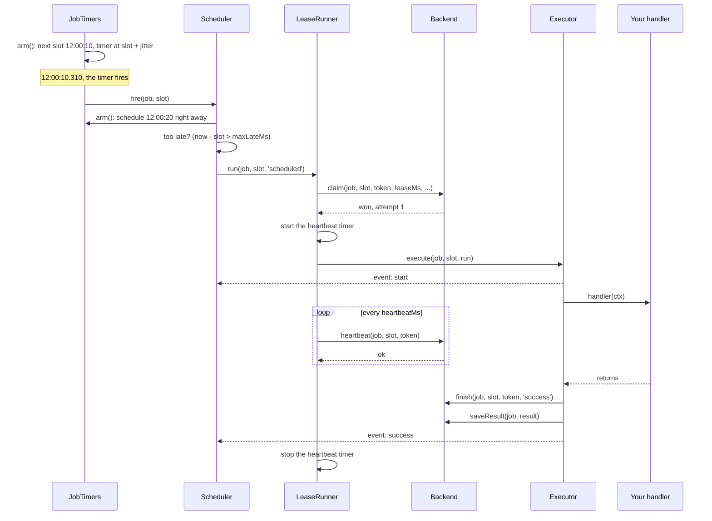
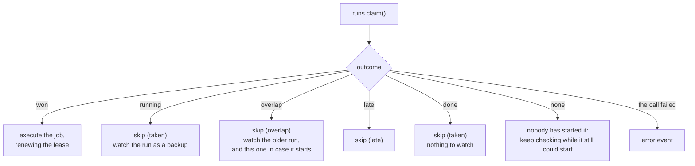
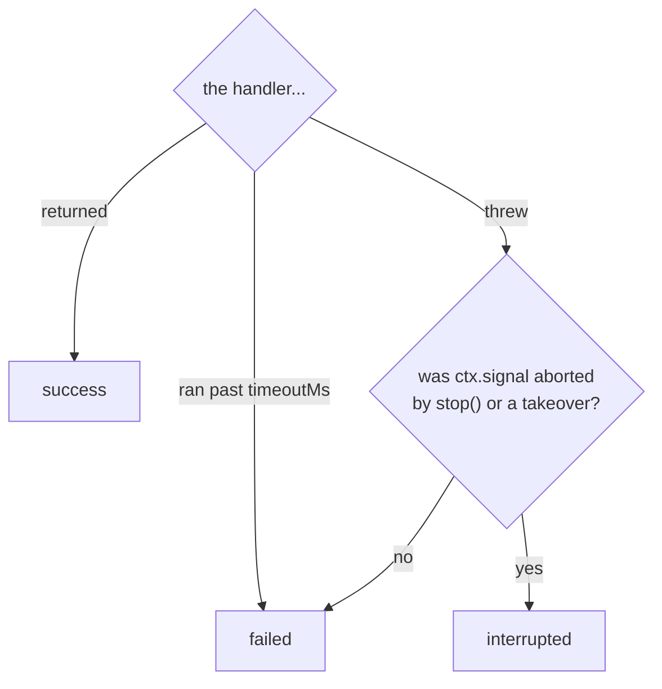
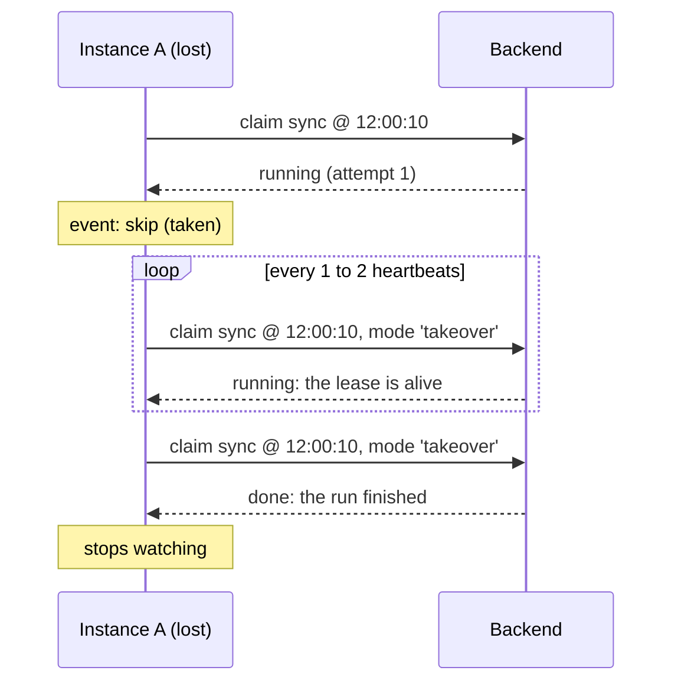
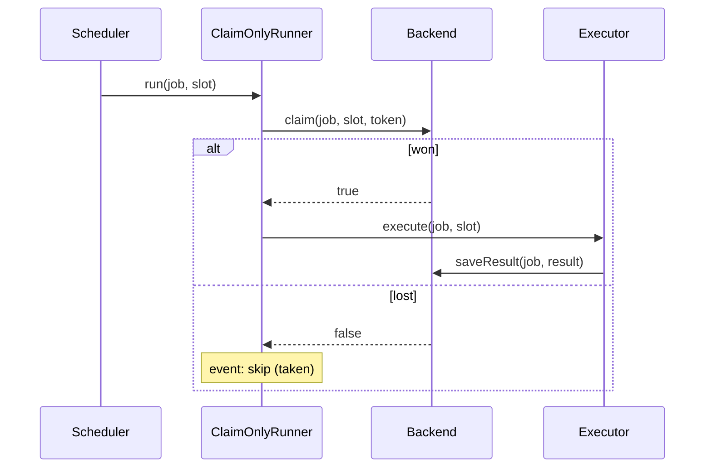
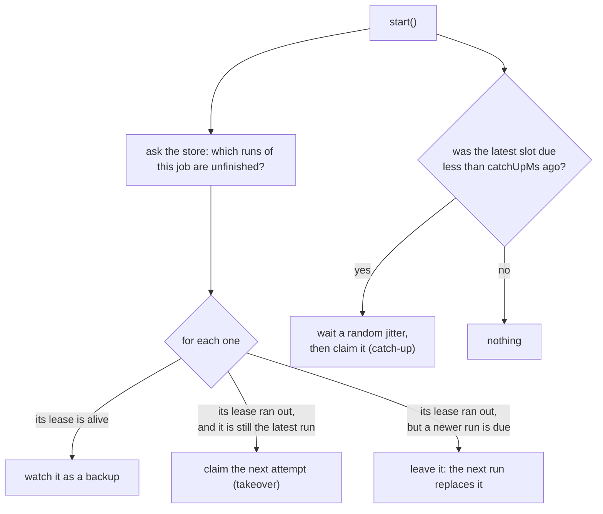

This page follows one run of one job through the code, on a lease backend. The job is `every('sync', '10s', handler)` and the run is the one due at 12:00:10.

## The whole path

## Step by step

### 1. Arming the timer

When the scheduler starts, and after every run fires, `JobTimers.arm()` asks the job's schedule for the first slot after now, and sets a timer for **slot + a random jitter**.

Timers are never set for longer than one minute. A longer wait is split, and the clock is checked again each time. That keeps a timer accurate over hours and makes the scheduler notice a clock change.

### 2. The timer fires

`Scheduler.fire()` does three things:

1. **Arms the next run first.** The next slot is scheduled before the current one is handled, so a long job never delays the schedule.
2. **Checks lateness locally.** If the instance reached this run more than `maxLateMs` after its slot (it was frozen, or the event loop was blocked), it emits `skip` with reason `'late'` and stops here.
3. **Hands the run to the runner.**

### 3. The claim

`LeaseRunner.run()` builds the claim. Besides the job and slot it carries a fresh random **token**, the lease length, the overlap rule and the attempt limit.

The backend answers with one of six outcomes:

| Outcome | Meaning | What this instance does |
| --- | --- | --- |
| `won` | This instance owns this attempt | Runs the handler |
| `running` | Another instance is running it, and its lease is alive | Becomes a backup |
| `overlap` | An earlier run of the job still has a live lease | Skips, and watches both runs |
| `late` | The claim reached the store too long after the slot, by the store's clock | Skips |
| `done` | The run already finished, or used up its attempts | Nothing |
| `none` | A backup asked about a run nobody has claimed | Keeps checking for a while |

### 4. Running the handler

`executeLeased()` starts a timer that sends a **heartbeat** every `heartbeatMs`, then calls the `Executor`.

The `Executor`:

1. Emits `start`.
2. Calls your handler with its context. `ctx.signal` belongs to this run only.
3. If `timeoutMs` is set, races the handler against a timer. When the timer wins, it aborts the signal and treats the run as failed.

### 5. Deciding how it ended

When the handler returns or throws, the `Executor` classifies the run:

A throw after `stop()` or a takeover is **interrupted**, not failed. The handler was asked to stop; it didn't break.

### 6. Recording the end

Two writes, in this order:

1. **`finish`** marks the run ended in the lease state, with the token. The heartbeat keeps running until this is stored: if the store is briefly unreachable at this moment, a backup must not re-run a job that already completed.
2. **`saveResult`** stores the history record: status, start and end time, duration, and the error message if there was one.

If the run was interrupted by `stop()`, the first step is a **release** instead of a finish: the lease is ended at once so a backup can take over without waiting.

Finally the `Executor` emits `success`, `failure` or `interrupted`.

## The same run, on the instances that lost

A backup's check is a claim in **takeover mode**: "give me the next attempt of this run if its lease has run out". While the lease is alive the answer is `running`, and nothing changes. The check happens at a random moment between one and two heartbeats, so backups don't all ask at once.

## On a claim-only backend

The path is shorter. There is no lease, so there are no heartbeats and no backups:

## What `start()` adds

On a lease backend, each job goes through **recovery** when the scheduler starts, before its first timer fires:

This is what makes a full restart safe: whichever instance comes back first picks up what was in progress.

## Next

- [Claim algorithms](../claim-algorithms/): what happens inside `claim()`
- [Leases](../leases/): heartbeats, takeover and fencing in detail
