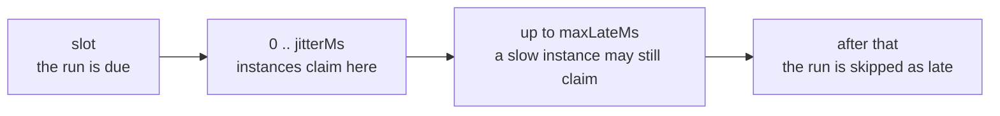
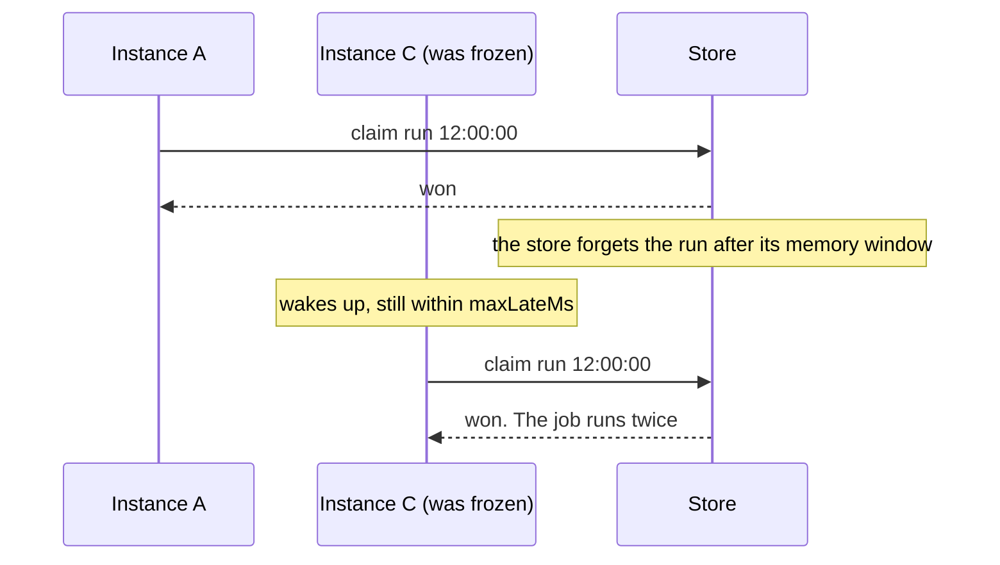
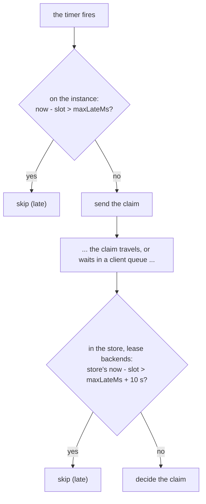

A distributed scheduler is mostly about time: when a run is due, how late an instance may be, and whose clock decides. This page gathers those rules in one place.

## The life of a slot, in time



| Time | Default | Decided by |
| --- | --- | --- |
| The slot | | The schedule: the same on every instance |
| Jitter window | 2 s (less for short intervals) | `jitterMs` |
| Lateness limit | 60 s | `maxLateMs` |

## Jitter

Each instance picks a new random delay between 0 and `jitterMs` for every run.

Without jitter, all instances would claim at the same instant, and the one with the fastest clock and network path would win nearly every time. With it, the winner is close to random, so the work spreads.

```
3 instances, jitterMs 2000, five runs: who asked first?

run 12:00:00   A +1 240   B   +310 *  C +1 870
run 12:00:10   A   +95 *  B +1 660    C   +720
run 12:00:20   A +1 900   B +1 020    C   +480 *
run 12:00:30   A   +610 * B +1 330    C +1 990
run 12:00:40   A +1 410   B   +250 *  C   +830
```

The default `jitterMs` is 2 seconds, lowered to a quarter of the interval for short intervals: a job that runs every second gets 250 ms.

Jitter also means a run starts up to `jitterMs` after its slot. Use `ctx.scheduledAt`, not the current time, when the job needs to know its nominal time.

## Rules anarchon enforces

When you add a job, anarchon checks its timings against each other and throws a `RangeError` if a combination is unsafe. It is better to fail at startup than to run a job twice at 3 a.m.

| Rule | Why |
| --- | --- |
| `jitterMs` < half the time between runs | Otherwise the jitter windows of two consecutive runs could meet |
| `maxLateMs` > `jitterMs` | An instance waiting its full jitter must not already be "late" |
| `jitterMs + maxLateMs` < the store's memory of a run | See below |
| `heartbeatMs` < half of `leaseMs` | A lease must be renewed at least twice before it can run out |

### How long the store must remember

An instance may send a claim up to `jitterMs + maxLateMs` after the slot. If the store has already forgotten that the run was taken, that late claim would win, and the job would run twice.



So anarchon requires the store's memory to be longer than the latest possible claim:

| Backend | Remembers a claimed run for | Setting |
| --- | --- | --- |
| Redis `lease`, PostgreSQL, SQLite | As long as a late claim could ask, whatever `historySize` is | Nothing to set |
| Redis `stream-id` | Forever | Nothing to set |
| Redis `idmp` | 5 min, and at most 1000 runs | `strategy.durationSec`, `strategy.maxSize` |
| Redis `script` | 5 min, and at most `historySize` runs | `strategy.windowMs` |
| RabbitMQ | 5 min | `slotTtlMs` |
| NATS | 5 min | `duplicateWindowMs` |

With the defaults (2 s + 60 s) every backend is safe. You only meet this rule if you raise `maxLateMs` a lot or shrink a window.

For the backends that also limit by **count** (`idmp`, `script`), the count times the interval must cover the same span: a job that runs every second with a memory of 50 runs only remembers 50 seconds.

## Lateness, checked twice

A run can be late for two different reasons, and each is checked where it can be seen.

**The instance was late.** Its timer fired long after the slot: the process was frozen, or the event loop was blocked. The instance compares its own clock with the slot and skips the run if it is more than `maxLateMs` behind.

**The claim was late.** The instance sent the claim on time, but it reached the store much later: the network stalled, or the client queued the command while reconnecting. The instance can't see this. So on lease backends the **store** checks again, on its own clock, inside the atomic claim: a new run whose slot is more than `maxLateMs` plus a 10-second tolerance in the past is refused.



## Which clock is used where

| Decision | Clock | Why |
| --- | --- | --- |
| When a slot is due on an instance | The instance's | Each instance fires its own timers |
| Whether a lease is alive | The store's | One clock for everyone: a difference between instances can't make a live lease look expired |
| Whether a claim arrived too late | The store's | The instance can't know how long its claim was in transit |

### What clock skew does

*Clock skew* is the difference between two machines' clocks.

- **Skew between instances** only shifts *who tends to win*. An instance whose clock runs 500 ms fast fires its timers 500 ms early and wins more often. Nothing breaks, because the claim is still atomic.
- **Skew between an instance and the store** matters only at the edges of the lateness check, which is why that check has a 10-second tolerance.
- **Large skew** (minutes) makes an instance claim runs minutes early or late. Past `maxLateMs`, its runs are refused as late.

Leases are immune to all of this, because lease ends are written and compared by the store alone.

:::tip
Run NTP, or your platform's time sync, on every machine. Sub-second accuracy is plenty.
:::

## Choosing lease timings

```
dead runner ── leaseMs ──► lease runs out ── up to 2 × heartbeatMs ──► takeover
```

| | `leaseMs` | `heartbeatMs` | Dead runner replaced within | A healthy runner survives a pause of |
| --- | --- | --- | --- | --- |
| Default | 30 s | 5 s | 40 s | about 25 s |
| Fast failover | 6 s | 1 s | 8 s | about 5 s |
| Patient | 120 s | 5 s | 130 s | about 115 s |

The last column is the trade-off. A lease must be longer than the longest pause a *healthy* runner can have: garbage collection, a slow disk, a short network drop. If it isn't, healthy runs get taken over, and you see `lost` events and duplicate work.

A reasonable starting point: `leaseMs` at least three times your worst expected pause, and the job's interval comfortably longer than `leaseMs`.

## Long timers

Node's timers drift over long waits, and a timer set for next month can't notice that the machine's clock was corrected. So anarchon never sets a timer for longer than one minute. A longer wait is a chain of one-minute timers, each re-reading the clock, and the run fires only when the clock actually reaches slot + jitter.

## Next

- [Leases](../leases/)
- [Job options](../../guides/job-options/)
