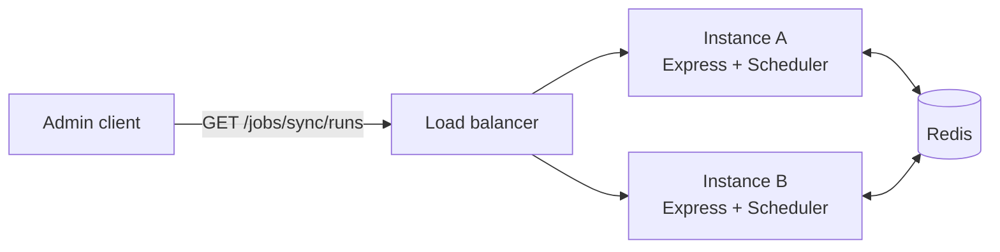

A common setup: the service that serves HTTP also runs the scheduled jobs, and exposes a few admin endpoints for them.

A runnable version of this recipe is in the repository as [`examples/http-api.ts`](https://github.com/aristoteliss/anarchon/blob/main/examples/http-api.ts), with every request in [`examples/http-api.http`](https://github.com/aristoteliss/anarchon/blob/main/examples/http-api.http) for the VS Code REST Client.

## The service

```ts
import express, { type NextFunction, type Request, type Response } from 'express';
import { Scheduler } from 'anarchon';

const PORT = Number(process.env.PORT ?? 3000);

const scheduler = new Scheduler({
  redis: process.env.REDIS_URL,
  instanceId: process.env.POD_NAME ?? `api-${PORT}`,
  timezone: 'Europe/Athens',
});

scheduler
  .every('sync', '10s', (ctx) => syncCustomers({ signal: ctx.signal }))
  .cron('digest', '0 8 * * 1-5', () => sendDigest());

scheduler.on('failure', (run) => console.error(`${run.job} failed: ${run.error}`));

const app = express();

// Jobs on this instance and their next run
app.get('/jobs', (_req, res) => {
  res.json(scheduler.jobs());
});

// Latest runs from all instances
app.get('/jobs/:name/runs', async (req, res) => {
  const limit = Number(req.query.limit ?? 20);
  res.json(await scheduler.history(req.params.name, limit));
});

// The latest run
app.get('/jobs/:name/last', async (req, res) => {
  res.json(await scheduler.lastRun(req.params.name));
});

// Run it now, on this instance. Answers when the job has finished.
app.post('/jobs/:name/run', async (req, res) => {
  res.json(await scheduler.runNow(req.params.name));
});

// An unknown job name or a bad limit throws: answer 400 with the message
app.use((error: unknown, _req: Request, res: Response, _next: NextFunction) => {
  res.status(400).json({ error: error instanceof Error ? error.message : String(error) });
});

async function main() {
  await scheduler.start();
  const server = app.listen(PORT, () => console.log(`listening on ${PORT}`));

  const shutdown = async () => {
    server.close();                               // stop taking requests
    await scheduler.stop({ timeoutMs: 20_000 });  // hand running jobs over
    process.exit(0);
  };
  process.on('SIGTERM', shutdown);
  process.on('SIGINT', shutdown);
}

main().catch((error) => {
  console.error(error);
  process.exit(1);
});
```

Express 5 forwards a rejected promise from an `async` handler to the error middleware. On Express 4, wrap the handlers or add `express-async-errors`.

## Trying it

```sh
curl localhost:3000/jobs
curl "localhost:3000/jobs/sync/runs?limit=5"
curl localhost:3000/jobs/sync/last
curl -X POST localhost:3000/jobs/sync/run
```

Start a second instance on another port, and `/jobs/sync/runs` on either one lists the runs of both:

```sh
PORT=3001 npx tsx app.ts
```

## How the pieces relate



- **`GET` endpoints** read from the store, so any instance gives the same answer.
- **`POST .../run`** runs the job on whichever instance the load balancer picked. That is fine for a manual run; it is recorded with that instance's name.

## Things to decide

### Protect the endpoints

`POST /jobs/:name/run` executes code on demand. Put it behind your normal authentication, and consider an allow-list of job names:

```ts
const RUNNABLE = new Set(['sync', 'digest']);

app.post('/jobs/:name/run', requireAdmin, async (req, res) => {
  if (!RUNNABLE.has(req.params.name)) return res.status(404).json({ error: 'not found' });
  res.json(await scheduler.runNow(req.params.name));
});
```

### Don't hold the request for long jobs

`runNow()` resolves when the job has finished. For a job that takes minutes, answer at once and let the caller poll the history:

```ts
app.post('/jobs/:name/run', requireAdmin, (req, res) => {
  scheduler.runNow(req.params.name).catch((error) => console.error(error));
  res.status(202).json({ started: true, history: `/jobs/${req.params.name}/runs` });
});
```

### A health check that reflects the jobs

```ts
app.get('/health/cron', async (_req, res) => {
  const last = await scheduler.lastRun('sync');
  const ageMs = last ? Date.now() - last.startedAt.getTime() : Infinity;
  const ok = ageMs < 30_000 && last?.status !== 'failed';
  res.status(ok ? 200 : 503).json({ ok, last });
});
```

Don't wire this into the load balancer's liveness check. A failing job is a reason to alert someone, not to restart every instance.

## With Fastify

The scheduler doesn't depend on the framework. The same service in Fastify:

```ts
import Fastify from 'fastify';

const app = Fastify();

app.get('/jobs', async () => scheduler.jobs());
app.get<{ Params: { name: string }; Querystring: { limit?: string } }>('/jobs/:name/runs', async (req) =>
  scheduler.history(req.params.name, Number(req.query.limit ?? 20)),
);
app.post<{ Params: { name: string } }>('/jobs/:name/run', async (req) => scheduler.runNow(req.params.name));

app.addHook('onClose', async () => {
  await scheduler.stop({ timeoutMs: 20_000 });
});

await scheduler.start();
await app.listen({ port: 3000 });

process.on('SIGTERM', () => app.close());
```

## Next

- [A worker process and a read-only API](../worker-and-api/): keep jobs out of the web processes
- [History](../../guides/history/)
