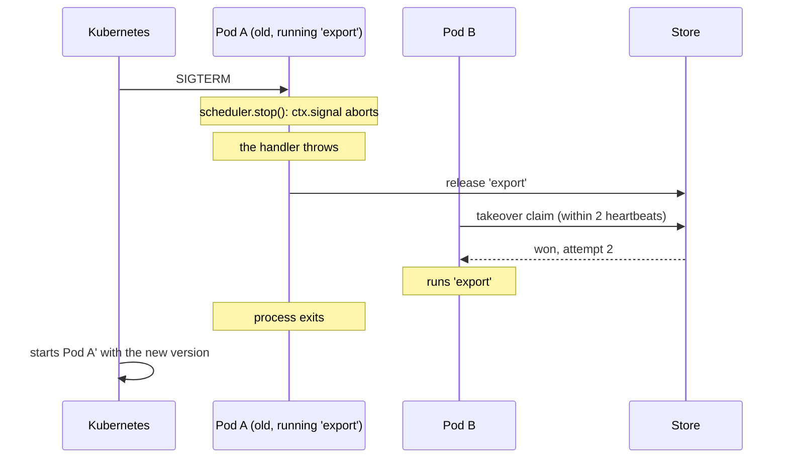

A rolling deploy stops pods one by one while new ones start. For a scheduler this is the most common "failure", and it should be a non-event: the pod being stopped hands its running job to another pod.

## What should happen



Three things make that work.

## 1. Call `stop()` on SIGTERM

Kubernetes sends `SIGTERM`, waits `terminationGracePeriodSeconds`, then sends `SIGKILL`.

```ts
const shutdown = async () => {
  server.close();                               // stop taking requests
  await scheduler.stop({ timeoutMs: 20_000 });  // hand running jobs over
  process.exit(0);
};
process.on('SIGTERM', shutdown);
```

:::caution[PID 1]
If your container starts Node through `npm start` or a shell script, the signal may never reach Node. Start it directly (`CMD ["node", "dist/main.js"]`), or use an init such as `tini`.
:::

## 2. Give it enough time

The grace period must be longer than the stop timeout, with room to spare:

```yaml
apiVersion: apps/v1
kind: Deployment
metadata:
  name: billing
spec:
  replicas: 3
  strategy:
    rollingUpdate:
      maxUnavailable: 1
      maxSurge: 1
  template:
    spec:
      terminationGracePeriodSeconds: 30   # > the stop timeout below (20 s)
      containers:
        - name: app
          image: billing:1.4.0
          env:
            - name: POD_NAME
              valueFrom:
                fieldRef:
                  fieldPath: metadata.name
            - name: REDIS_URL
              valueFrom:
                secretKeyRef:
                  name: billing-secrets
                  key: redis-url
```

| Setting | Value | Why |
| --- | --- | --- |
| `stop({ timeoutMs })` | 20 s | How long to wait for handlers to stop |
| `terminationGracePeriodSeconds` | 30 s | Must be longer, or the pod is killed mid-stop |

If the pod is killed before `stop()` finishes, nothing breaks, but the job isn't handed over: a backup takes it over after the lease runs out instead of within two heartbeats.

## 3. Handlers that stop when asked

`stop()` aborts `ctx.signal`. A handler that throws at that point is handed over at once. One that ignores the signal holds the pod until the stop timeout.

```ts
scheduler.every('export', '15m', async (ctx) => {
  for (const batch of await loadBatches(ctx.slot)) {
    ctx.signal.throwIfAborted();
    await exportBatch(batch);
  }
});
```

## Name instances after pods

The default `instanceId` is `hostname:pid`. In a container the hostname is already the pod name, so the default reads like `billing-7d9f8c-x2x4q:1`. Passing the pod name explicitly is tidier:

```ts
new Scheduler({ redis: process.env.REDIS_URL, instanceId: process.env.POD_NAME });
```

History then shows which pod ran each run:

```
2026-10-10T12:15:00.000Z billing-7d9f8c-k8m2p 2 success      <- took over
2026-10-10T12:15:00.000Z billing-7d9f8c-x2x4q 1 interrupted  <- the pod that was replaced
```

## How many replicas

- **Two or more.** With one replica there is no backup while it restarts. On a lease backend the run is recovered when the pod is back, so it is delayed, not lost.
- **`maxUnavailable: 1`**, so most pods stay up during a rollout and can take over.

## Changing a schedule in a deploy

During a rollout, old and new pods run together for a while. If the new version changes a job's schedule, the two groups compute different slots, and for that moment both schedules are active.

For most jobs that is harmless. When it isn't:

- give the changed job a **new name** in the new version, or
- roll out with the `Recreate` strategy for that deploy.

## Autoscaling

Adding or removing pods needs nothing special. A new pod starts claiming at its next slot. A pod removed by the autoscaler gets the same `SIGTERM` as in a deploy.

## Liveness and readiness

Don't tie either probe to job results:

- A **failing job** is an alert, not a reason to restart pods. Restarting all of them because a third-party API is down makes things worse.
- **Readiness** should reflect the ability to serve requests.

If you want a signal that the scheduler itself is alive, expose one that checks the store is reachable.

## A checklist

- [ ] `scheduler.stop()` runs on `SIGTERM`
- [ ] Node receives the signal (it is PID 1, or there is an init)
- [ ] `terminationGracePeriodSeconds` is longer than the stop timeout
- [ ] Handlers check `ctx.signal`
- [ ] At least two replicas
- [ ] `instanceId` is the pod name

## Next

- [Lifecycle](../../guides/lifecycle/#graceful-shutdown)
- [Failure scenarios](../../internals/failure-scenarios/#5-the-runner-is-stopped-gracefully)
