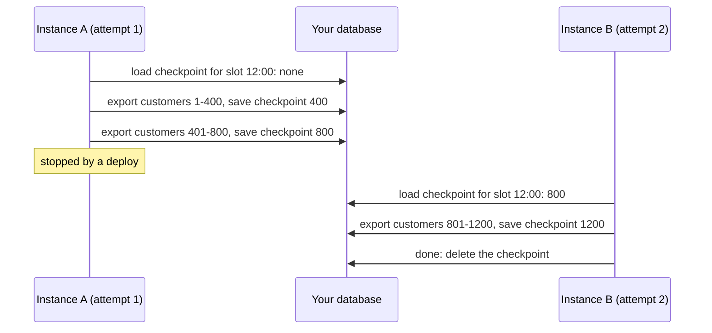

A job that runs for a long time is more likely to be interrupted by a deploy, a crash or a timeout. This recipe makes such a job stop quickly, and continue where it left off instead of starting over.

## The starting point

```ts
scheduler.every('export', '1h', async (ctx) => {
  for (const customer of await allCustomers()) {
    await exportCustomer(customer);
  }
});
```

Problems:

1. It ignores `ctx.signal`. A deploy has to wait for the whole export, or kill it.
2. If it hangs, it blocks every later run forever.
3. After a takeover, attempt 2 exports everything again.

## Step 1: stop when asked

```ts
scheduler.every('export', '1h', async (ctx) => {
  for (const customer of await allCustomers()) {
    ctx.signal.throwIfAborted();
    await exportCustomer(customer, { signal: ctx.signal });
  }
});
```

Now a deploy interrupts the job between two customers, and the run is handed to another instance.

## Step 2: a timeout

With `overlap: 'skip'`, a run that never ends blocks the job. Put a ceiling on it:

```ts
scheduler.every('export', '1h', handler, { timeoutMs: 50 * 60_000 });
```

When the timeout passes, `ctx.signal` aborts and the run is recorded as failed. Because the handler checks the signal, it actually stops.

## Step 3: checkpoints

anarchon restarts an interrupted run from the beginning of the handler. To continue from the middle, the **job** has to remember its progress. `ctx.slot` is the key: it is the same on every attempt of the same run.



```ts
scheduler.every(
  'export',
  '1h',
  async (ctx) => {
    // Progress of THIS run. Attempt 2 finds what attempt 1 saved.
    let after = (await checkpoints.get('export', ctx.slot)) ?? 0;

    for (;;) {
      ctx.signal.throwIfAborted();
      const batch = await customersAfter(after, 200);
      if (batch.length === 0) break;

      await exportBatch(batch, { signal: ctx.signal });

      after = batch[batch.length - 1].id;
      await checkpoints.set('export', ctx.slot, after);
    }

    await checkpoints.delete('export', ctx.slot);
  },
  { timeoutMs: 50 * 60_000 },
);
```

A checkpoint table can be as small as this:

```sql
CREATE TABLE job_checkpoints (
  job TEXT NOT NULL,
  slot BIGINT NOT NULL,
  position BIGINT NOT NULL,
  PRIMARY KEY (job, slot)
);
```

### Make each batch idempotent

A batch can be exported and the instance die before the checkpoint is saved. The next attempt then repeats that batch. So the batch itself must be safe to repeat:

```ts
async function exportBatch(batch: Customer[]) {
  for (const customer of batch) {
    await warehouse.upsert('customers', { id: customer.id, ...customer }); // upsert, not insert
  }
}
```

## Step 4: tell the attempts apart

```ts
if (ctx.attempt > 1) {
  logger.warn(`export ${ctx.scheduledAt.toISOString()}: attempt ${ctx.attempt}, continuing after ${after}`);
}
```

## Lease timing for long jobs

The lease has nothing to do with how long the job runs. A job can run for hours with a 30-second lease, because the lease is renewed every few seconds for as long as the handler is alive.

What does matter is that the event loop keeps turning. The heartbeat is a timer; a handler that blocks the thread for longer than `leaseMs` stops its own heartbeats and loses the run.

```ts
// Blocks the thread: no heartbeat can be sent while this runs
const result = hugeArray.map(expensiveSyncComputation);
```

For heavy CPU work:

- break it into chunks and yield between them (`await new Promise(setImmediate)`), or
- move it to a worker thread and `await` its result, or
- raise `leaseMs` above the longest block.

## Jobs longer than their interval

If "export" takes 90 minutes and runs hourly, every second run is skipped as an overlap. That is correct, but it is usually a sign that the schedule should change:

| Situation | Option |
| --- | --- |
| The job sometimes overruns | Keep `overlap: 'skip'`; an occasional skipped run is fine |
| The job always overruns | Lengthen the interval |
| Each run covers its own time window and must not be skipped | `overlap: 'allow'`, with each run working on `ctx.slot`'s window |

## Next

- [Writing handlers](../../guides/writing-handlers/)
- [Leases](../../internals/leases/)
