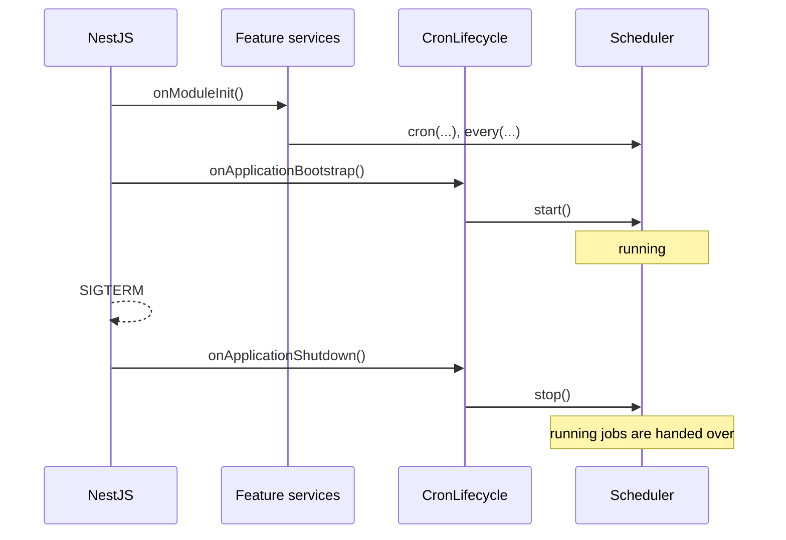

In NestJS the scheduler fits naturally as a provider. One module creates it and ties it to the application's lifecycle; feature services inject it and register their own jobs.

:::note
`@nestjs/schedule` runs every `@Cron()` method in **every** instance. anarchon is what you reach for when the app runs as more than one instance and a job must run once.
:::

A runnable NestJS app is in the repository as [`examples/nestjs`](https://github.com/aristoteliss/anarchon/tree/main/examples/nestjs), checked on NestJS 11 and 12. See [Declaring jobs with decorators](#declaring-jobs-with-decorators).

## The module

```ts
// cron/cron.module.ts
import { Global, Injectable, Module, type OnApplicationBootstrap, type OnApplicationShutdown } from '@nestjs/common';
import { ConfigService } from '@nestjs/config';
import { Scheduler } from 'anarchon';

/** Starts the scheduler when the app is ready, and stops it when the app shuts down. */
@Injectable()
class CronLifecycle implements OnApplicationBootstrap, OnApplicationShutdown {
  constructor(private readonly scheduler: Scheduler) {}

  async onApplicationBootstrap(): Promise<void> {
    await this.scheduler.start();
  }

  async onApplicationShutdown(): Promise<void> {
    await this.scheduler.stop({ timeoutMs: 20_000 });
  }
}

@Global()
@Module({
  providers: [
    {
      provide: Scheduler,
      inject: [ConfigService],
      useFactory: (config: ConfigService) =>
        new Scheduler({
          redis: config.getOrThrow<string>('REDIS_URL'),
          prefix: 'billing:cron:',
          instanceId: config.get<string>('POD_NAME'),
          timezone: 'Europe/Athens',
        }),
    },
    CronLifecycle,
  ],
  exports: [Scheduler],
})
export class CronModule {}
```

## Registering jobs in a feature service

Register jobs in `onModuleInit`. NestJS calls it on every provider before `onApplicationBootstrap`, so all jobs exist by the time the scheduler starts.

```ts
// invoices/invoices.service.ts
import { Injectable, Logger, type OnModuleInit } from '@nestjs/common';
import { type JobContext, Scheduler } from 'anarchon';

@Injectable()
export class InvoicesService implements OnModuleInit {
  private readonly logger = new Logger(InvoicesService.name);

  constructor(private readonly scheduler: Scheduler) {}

  onModuleInit(): void {
    this.scheduler.cron('monthly-invoices', '0 6 1 * *', (ctx) => this.buildInvoices(ctx), {
      timeoutMs: 30 * 60_000,
      catchUpMs: 6 * 60 * 60_000,
    });
  }

  private async buildInvoices(ctx: JobContext): Promise<void> {
    this.logger.log(`building invoices for ${ctx.scheduledAt.toISOString()} (attempt ${ctx.attempt})`);
    for (const customer of await this.customers()) {
      ctx.signal.throwIfAborted();
      await this.createInvoice(customer, ctx.slot); // idempotent on (customer, slot)
    }
  }

  // ...
}
```

Use an arrow function, as above, so `this` stays the service inside the handler.

## Declaring jobs with decorators

A provider can declare its jobs with anarchon's [decorators](../../guides/decorators/) instead of calling `cron()` and `every()`. Each job calls its method on the provider, so no arrow function is needed.

NestJS compiles with legacy decorators (`experimentalDecorators`). In that style a method decorator can't act when the provider is created, so the provider gets its jobs onto the scheduler in one of two ways.

**With `@Scheduled()`.** The provider adds its jobs when Nest creates it, and doesn't need the scheduler injected:

```ts
// reports/reports.service.ts
import { Injectable } from '@nestjs/common';
import { Every, type JobContext, Scheduled } from 'anarchon';

@Injectable()
@Scheduled()
export class ReportsService {
  constructor(private readonly mailer: MailerService) {}

  @Every('sync-reports', '10s', { timeoutMs: 8_000 })
  async sync(ctx: JobContext): Promise<void> {
    // ...
  }
}
```

**With `register(this)`.** The provider registers itself in `onModuleInit`:

```ts
// invoices/invoices.service.ts
import { Injectable, type OnModuleInit } from '@nestjs/common';
import { Cron, type JobContext, Scheduler } from 'anarchon';

@Injectable()
export class InvoicesService implements OnModuleInit {
  constructor(private readonly scheduler: Scheduler) {}

  onModuleInit(): void {
    this.scheduler.register(this);
  }

  @Cron('monthly-invoices', '0 6 1 * *', { timeoutMs: 30 * 60_000, catchUpMs: 6 * 60 * 60_000 })
  async buildInvoices(ctx: JobContext): Promise<void> {
    // ...
  }
}
```

| | `@Scheduled()` | `register(this)` |
| --- | --- | --- |
| The provider needs the `Scheduler` injected | No | Yes |
| The scheduler that gets the jobs | The default one: the first scheduler created | The one you inject |
| The class Nest sees | A subclass with the same name | The class as you wrote it |

Both ways run in the example app of the repository, [`examples/nestjs`](https://github.com/aristoteliss/anarchon/tree/main/examples/nestjs), and its check passes on NestJS 11 and 12. anarchon has no NestJS-specific code and needs no adapter package: the app uses only the public API. Constructor injection works with `@Scheduled()` above or below `@Injectable()`.

| Command | What it does |
| --- | --- |
| `pnpm --filter anarchon-example-nestjs start` | Runs the app on the installed NestJS (12) |
| `pnpm --filter anarchon-example-nestjs start:nest11` | Runs the same source on NestJS 11 |
| `pnpm --filter anarchon-example-nestjs test` | Checks the app on both versions |

Things to know:

- **The order of creation doesn't matter.** Nest may create a provider before the scheduler. Its jobs are then added when the scheduler starts, in `onApplicationBootstrap`.
- **Forgetting both is reported.** A provider with neither `@Scheduled()` nor `register(this)` adds no jobs, and the scheduler warns when it starts:

  ```
  [anarchon] @Every "sync-reports" on ReportsService.sync is not scheduled: with legacy decorators, add @Scheduled() to the class or call scheduler.register(object)
  ```

- **Singleton providers only.** Each object of a decorated class adds the same jobs, so a second one throws `Job "..." is already registered`. Don't decorate request-scoped or transient providers.
- **Import injected classes as values.** Nest reads the types of constructor parameters at run time. A lint rule that rewrites `import { Scheduler }` to `import type { Scheduler }` breaks the injection.

:::caution[Import `Cron` from `anarchon`]
`@nestjs/schedule` exports a decorator with the same name, and that one runs the method in every instance.
:::

## Enable shutdown hooks

NestJS only calls `onApplicationShutdown` if shutdown hooks are enabled. Without this line, `SIGTERM` kills the process without handing running jobs over:

```ts
// main.ts
import { NestFactory } from '@nestjs/core';
import { AppModule } from './app.module';

async function bootstrap() {
  const app = await NestFactory.create(AppModule);
  app.enableShutdownHooks();
  await app.listen(3000);
}
bootstrap();
```

## The lifecycle, in order



## Logging through Nest

```ts
import { Logger } from '@nestjs/common';

const logger = new Logger('Cron');

new Scheduler({
  redis: config.getOrThrow<string>('REDIS_URL'),
  log: true,
  logger: {
    info: (message) => logger.log(message),
    warn: (message) => logger.warn(message),
    error: (message) => logger.error(message),
  },
});
```

## Events as providers

For alerts and metrics, subscribe in a service of its own:

```ts
@Injectable()
export class CronAlerts implements OnModuleInit {
  constructor(
    private readonly scheduler: Scheduler,
    private readonly alerts: AlertsService,
  ) {}

  onModuleInit(): void {
    this.scheduler.on('failure', (run) => {
      void this.alerts.send(`${run.job} failed on ${run.instanceId}: ${run.error}`);
    });
  }
}
```

## An admin controller

```ts
import { Controller, Get, Param, Post, Query, UseGuards } from '@nestjs/common';
import { Scheduler } from 'anarchon';

@Controller('jobs')
@UseGuards(AdminGuard)
export class JobsController {
  constructor(private readonly scheduler: Scheduler) {}

  @Get()
  list() {
    return this.scheduler.jobs();
  }

  @Get(':name/runs')
  runs(@Param('name') name: string, @Query('limit') limit = '20') {
    return this.scheduler.history(name, Number(limit));
  }

  @Post(':name/run')
  run(@Param('name') name: string) {
    return this.scheduler.runNow(name);
  }
}
```

## With PostgreSQL and TypeORM or Prisma

If the app has no Redis, use the database it already has. Give anarchon its own small pool rather than sharing the ORM's connection:

```ts
import { PostgresBackend, Scheduler } from 'anarchon';

{
  provide: Scheduler,
  inject: [ConfigService],
  useFactory: (config: ConfigService) =>
    new Scheduler({
      backend: new PostgresBackend({
        connection: config.getOrThrow<string>('DATABASE_URL'),
        table: 'jobs.cron_runs',
      }),
    }),
}
```

## Next

- [Rolling deploys on Kubernetes](../kubernetes/)
- [Writing handlers](../../guides/writing-handlers/)
