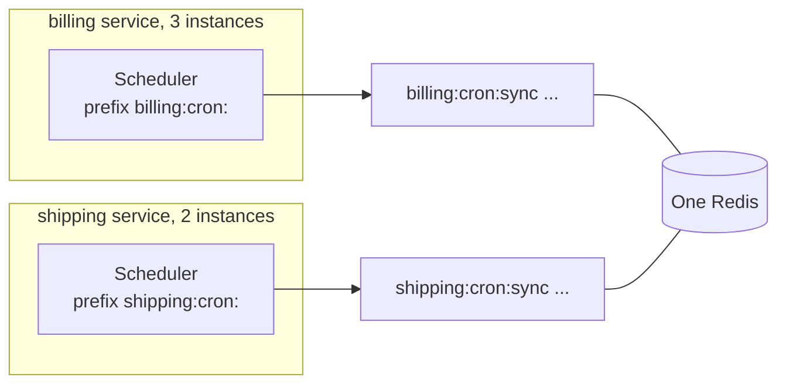

Two services that share a Redis or a database must not see each other's jobs. If both have a job called `sync` under the same namespace, they compete for the same runs, and each run happens in only one of the two services.

The fix is a **namespace** per group of instances that should share jobs.



## The option, per backend

| Backend | Option | Default |
| --- | --- | --- |
| Redis / Valkey | `prefix` | `'cron:'` |
| PostgreSQL / SQLite | `table` | `'anarchon_runs'` |
| RabbitMQ | `prefix` | `'cron.'` |
| NATS | `prefix`, `stream` | `'cron.'`, `'CRON'` |

The rule: instances that should **share** jobs use the same value, and everything else uses a different one.

## Per service

```ts
// billing
new Scheduler({ backend: new RedisBackend({ redis: process.env.REDIS_URL, prefix: 'billing:cron:' }) });

// shipping
new Scheduler({ backend: new RedisBackend({ redis: process.env.REDIS_URL, prefix: 'shipping:cron:' }) });
```

```ts
// PostgreSQL: a table per service, or a schema
new PostgresBackend({ connection: pool, table: 'billing_cron_runs' });
new PostgresBackend({ connection: pool, table: 'shipping.cron_runs' });
```

## Per environment

Staging and production should not share a store at all. When they must (a shared development Redis, for example), put the environment in the namespace:

```ts
new Scheduler({
  backend: new RedisBackend({
    redis: process.env.REDIS_URL,
    prefix: `${process.env.APP_ENV}:billing:cron:`, // staging:billing:cron:
  }),
});
```

Without this, a developer's laptop pointed at the shared Redis takes runs away from staging.

## Per tenant

When each tenant should have its own run of a job, there are two designs.

### One job, looping over tenants

Simplest, and enough for most cases:

```ts
scheduler.every('tenant-reports', '1h', async (ctx) => {
  for (const tenant of await tenants()) {
    ctx.signal.throwIfAborted();
    await buildReport(tenant, ctx.slot);
  }
});
```

One instance handles all tenants for that hour.

### One job per tenant

Each tenant's job is claimed separately, so the work spreads across instances and one slow tenant doesn't delay the others:

```ts
for (const tenant of await tenants()) {
  scheduler.every(`report-${tenant.id}`, '1h', (ctx) => buildReport(tenant, ctx.slot));
}
```

Every instance must register the same set of jobs. When tenants are added at run time, each instance has to learn about it: reload the tenant list periodically and call `every()` for new ones and `remove()` for deleted ones.

```ts
async function syncTenantJobs() {
  const wanted = new Set((await tenants()).map((t) => `report-${t.id}`));
  const have = new Set(scheduler.jobs().map((j) => j.name).filter((n) => n.startsWith('report-')));

  for (const name of wanted) {
    if (!have.has(name)) scheduler.every(name, '1h', (ctx) => buildReport(name.slice('report-'.length), ctx.slot));
  }
  for (const name of have) {
    if (!wanted.has(name)) scheduler.remove(name);
  }
}

setInterval(syncTenantJobs, 60_000);
```

Each job has its own keys or rows, so thousands of tenant jobs mean thousands of small entries. That is fine on Redis and PostgreSQL. With RabbitMQ, which creates a queue per run, prefer the looping design.

## Several schedulers in one process

One process can hold more than one scheduler, for example one per store, or one per group of jobs with different lease timings:

```ts
const fast = new Scheduler({ backend: new RedisBackend({ redis, prefix: 'app:fast:' }), leaseMs: 6_000, heartbeatMs: 1_000 });
const slow = new Scheduler({ backend: new RedisBackend({ redis, prefix: 'app:slow:' }), leaseMs: 120_000 });

fast.every('refresh-cache', '5s', refresh);
slow.cron('rebuild-index', '0 2 * * *', rebuild, { timeoutMs: 2 * 60 * 60_000 });

await Promise.all([fast.start(), slow.start()]);
```

Give them different prefixes, and stop both on shutdown.

## Reading across services

A dashboard can read every service's history by creating one reader per namespace:

```ts
const readers = {
  billing: new Scheduler({ backend: new RedisBackend({ redis, prefix: 'billing:cron:' }) }),
  shipping: new Scheduler({ backend: new RedisBackend({ redis, prefix: 'shipping:cron:' }) }),
};

app.get('/:service/jobs/:name/runs', async (req, res) => {
  const reader = readers[req.params.service as keyof typeof readers];
  if (!reader) return res.status(404).end();
  res.json(await reader.history(req.params.name, 20));
});
```

## Next

- [Backends overview](../../backends/overview/)
- [A worker process and a read-only API](../worker-and-api/)
