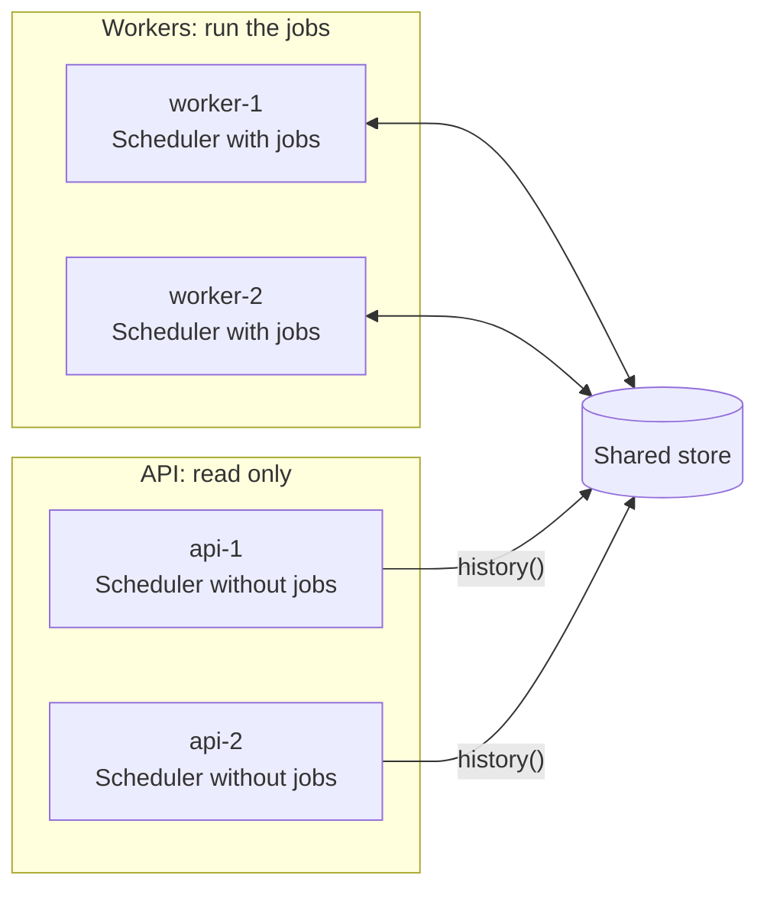

You don't have to run jobs in the processes that serve requests. A common split:

- **Workers** register the jobs and run them. Run two or more for availability.
- **API processes** register nothing. They only read history and, if you want, start manual runs through a worker.



## Why split

- A heavy job can't slow down request handling.
- Workers can be sized, scaled and deployed separately.
- The web processes need no job code or job dependencies.

## The shared configuration

Both sides must point at the same store and namespace. Keep that in one place:

```ts
// cron/config.ts
import type { SchedulerOptions } from 'anarchon';

export const cronOptions: SchedulerOptions = {
  redis: process.env.REDIS_URL,
  prefix: 'billing:cron:',
  timezone: 'Europe/Athens',
};
```

## The worker

```ts
// worker.ts
import { Scheduler } from 'anarchon';
import { cronOptions } from './cron/config';

const scheduler = new Scheduler({ ...cronOptions, instanceId: process.env.POD_NAME, log: true });

scheduler
  .every('sync', '10s', (ctx) => syncCustomers({ signal: ctx.signal }))
  .every('export', '15m', (ctx) => exportAll(ctx), { timeoutMs: 10 * 60_000 })
  .cron('digest', '0 8 * * 1-5', () => sendDigest());

async function main() {
  await scheduler.start();
  const shutdown = async () => {
    await scheduler.stop({ timeoutMs: 25_000 });
    process.exit(0);
  };
  process.on('SIGTERM', shutdown);
  process.on('SIGINT', shutdown);
}

main().catch((error) => {
  console.error(error);
  process.exit(1);
});
```

Run at least two workers. With one, a crash means nobody is left to take the run over until it restarts. On a lease backend the restarted worker still recovers the run on start, so nothing is lost, only delayed.

## The API

The API process creates a scheduler with **no jobs** and never calls `start()`. `history()` and `lastRun()` connect on their own.

```ts
// api.ts
import express from 'express';
import { Scheduler } from 'anarchon';
import { cronOptions } from './cron/config';

const reader = new Scheduler(cronOptions);
const app = express();

app.get('/jobs/:name/runs', async (req, res) => {
  res.json(await reader.history(req.params.name, Number(req.query.limit ?? 20)));
});

app.get('/jobs/:name/last', async (req, res) => {
  res.json(await reader.lastRun(req.params.name));
});

const server = app.listen(3000);

process.on('SIGTERM', async () => {
  server.close();
  await reader.stop(); // closes its connection
  process.exit(0);
});
```

What a reader can and can't do:

| Method | On a reader without jobs |
| --- | --- |
| `history(name)`, `lastRun(name)` | Works for any job name |
| `jobs()` | Empty: it lists jobs registered on *this* instance |
| `nextRun(name)` | Throws: the job isn't registered here |
| `runNow(name)` | Throws: the job isn't registered here |

## Showing the schedule in the API

The API doesn't know the schedules, since it registers no jobs. Two ways to show them:

**Share the definitions.** Put names and schedules in a module both sides import. The worker attaches handlers; the API only reads the list.

```ts
// cron/definitions.ts
export const JOBS = [
  { name: 'sync', kind: 'every', schedule: '10s' },
  { name: 'export', kind: 'every', schedule: '15m' },
  { name: 'digest', kind: 'cron', schedule: '0 8 * * 1-5' },
] as const;
```

**Or ask a worker.** Give workers a small internal HTTP endpoint that returns `scheduler.jobs()`.

## Manual runs from the API

`runNow()` runs on the instance it is called on, and the API has no job code. Forward the request to a worker:

```ts
// in the worker: a small internal server
import { createServer } from 'node:http';

createServer(async (req, res) => {
  const match = /^\/run\/([\w-]+)$/.exec(req.url ?? '');
  if (req.method !== 'POST' || !match) return res.writeHead(404).end();
  try {
    const run = await scheduler.runNow(match[1]);
    res.writeHead(200, { 'content-type': 'application/json' }).end(JSON.stringify(run));
  } catch (error) {
    res.writeHead(400).end(String(error));
  }
}).listen(9100);
```

```ts
// in the API
app.post('/jobs/:name/run', requireAdmin, async (req, res) => {
  const response = await fetch(`http://cron-worker:9100/run/${req.params.name}`, { method: 'POST' });
  res.status(response.status).send(await response.text());
});
```

## One code base, two modes

If you'd rather ship one image, choose the mode with an environment variable:

```ts
const scheduler = new Scheduler({ ...cronOptions, instanceId: process.env.POD_NAME });

if (process.env.RUN_JOBS === 'true') {
  registerJobs(scheduler);
  await scheduler.start();
}
```

Processes with `RUN_JOBS` unset behave as readers.

## Next

- [Rolling deploys on Kubernetes](../kubernetes/)
- [History](../../guides/history/)
